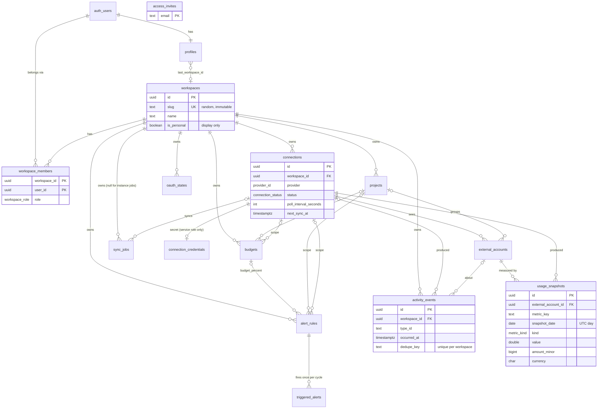

# Database schema

The schema lives in `supabase/migrations/`, forward-only:

| Migration | Contents |
|---|---|
| `20261031090000_tenancy.sql` | Roles, `profiles`, `workspaces`, `workspace_members`, `has_workspace_role`, `create_workspace`, sign-up trigger, last-owner rule, slug immutability |
| `20261031090100_integrations.sql` | `projects`, `connections`, `connection_credentials`, `oauth_states`, `external_accounts` |
| `20261031090200_metrics_events_alerts.sql` | `usage_snapshots`, `activity_events`, `budgets`, `alert_rules`, `triggered_alerts` |
| `20261031090300_jobs_and_invites.sql` | `pg_cron`, `pg_net`, `sync_jobs`, `claim_sync_jobs`, `access_invites`, `hook_before_user_created` |
| `20261031100000_sync_engine.sql` | One open sync per connection, `enqueue_sync_job`, `request_manual_sync`, `enqueue_due_syncs`, `latest_usage_resets`, and the retention purges for snapshots, events, and jobs |
| `20261031100100_oauth_state_pending_installation.sql` | `oauth_states.reconnect_connection_id` and `pending_installation_id` |
| `20261031100200_daily_summary_jobs.sql` | `daily_summary` jobs and `enqueue_daily_summaries` |
| `20261031100300_review_round_one.sql` | Drops `connection_credentials.access_expires_at` and `oauth_states.redirect_after` (never read); adds `purge_oauth_states` |
| `20261104090000_realtime_publication.sql` | Publishes `activity_events`, `usage_snapshots`, `connections`, and `triggered_alerts` to Supabase Realtime |

`supabase/seed.sql` loads synthetic local data: two invited users, each with a personal workspace, sharing the workspace Acme (one owner, one viewer) with one project, one `fake` connection, three days of snapshots, and a few events. Its header lists the fixed UUIDs tests can use.

## Entity relationships

What each of these is for, and how workspaces, connections, external accounts, and projects fit together: [Workspaces, connections, accounts, and projects](concepts.md).

`access_invites` stands alone: the before-user-created hook reads it to admit an invited email.

References between two tenant rows are composite foreign keys on `(workspace_id, x_id)`, so the database refuses a budget, rule, mapping, or snapshot that points at another workspace's row even if a caller learns its UUID.

## Roles and row level security

Every table in `public` has RLS enabled. Policies call one helper, `public.has_workspace_role(workspace_id, min_role)`, which reads the caller's role from `workspace_members` at query time (never from JWT claims), so a role change applies on the next request. Ranks: viewer 1, admin 2, owner 3.

| Table | Read | Write through the Data API |
|---|---|---|
| `workspaces` | viewer | rename: admin; delete: owner; create: only `create_workspace` (service role) |
| `workspace_members` | viewer | owner manages any row; admin manages non-owner rows; only an owner grants `owner` |
| `projects`, `connections`, `external_accounts`, `budgets`, `alert_rules` | viewer | admin |
| `usage_snapshots`, `activity_events`, `sync_jobs` | viewer | none (service role) |
| `triggered_alerts` | viewer | admin acknowledges (`acknowledged_at`, `acknowledged_by` only, in their own name) |
| `profiles` | own row | own row |
| `connection_credentials`, `oauth_states`, `access_invites` | none | none (service role; the auth hook reads invites) |

Defense in depth, following BackTalk's hardening:

- Table privileges are revoked from `anon` and `authenticated`, then `authenticated` gets `select` plus only the columns the app writes. Identity, tenancy, provenance, and audit columns are never writable through the Data API. `created_by` and `updated_by` default to `auth.uid()`, and a trigger sets `updated_by` on every signed-in update.
- Every function revokes `execute` from `public` and `anon`; `security definer` functions pin `search_path = ''`, and the authorization helper only ever answers for the caller.
- The database keeps at least one owner per workspace: a deferred constraint trigger on `workspace_members` rejects the commit otherwise. Deleting a user first deletes workspaces where they are the only member; a shared workspace where they are the only owner blocks the deletion until ownership moves.
- `is_personal` is display only. Nothing authorizes on it.

The app mirrors this matrix in one server-side guard (`canPerform`) so users get a clear reason; RLS stays the backstop.

## Workspaces and sign-up

`public.create_workspace(user_id, name, is_personal)` is the only way to create a workspace. It writes the workspace and the owner membership in one transaction. A partial unique index allows one personal workspace per user, and the function returns the existing one on a repeat call, so sign-up is idempotent. The `on_auth_user_created` trigger on `auth.users` creates the profile (display name from GitHub's `user_name`, else `name`) and the personal workspace, and points `profiles.last_workspace_id` at it.

Slugs are 10 random lowercase base32 characters, never derived from the name, and a trigger rejects any change, so renaming never breaks a URL.

## Invite-only sign-up

`public.hook_before_user_created(event jsonb)` returns `{}` when `lower(event.user.email)` is in `access_invites` and a 403 error object otherwise. Supabase Auth calls it for every user creation, including GitHub OAuth and the admin API, so test fixtures add their emails to `access_invites` first, as the seed does. Enable it in `supabase/config.toml` under `[auth.hook.before_user_created]` with `uri = "pg-functions://postgres/public/hook_before_user_created"`.

## Why snapshots double as current metrics

`usage_snapshots` holds one row per external account, metric key, and UTC day. Every sync upserts today's row, so the row for the latest `snapshot_date` per `(external_account_id, metric_key)` is the current value, and earlier rows are the daily history for charts. One table means:

- No second "current metrics" table to keep in step with history, and no window where the dashboard and the chart disagree.
- The unique key `(external_account_id, metric_key, snapshot_date)` makes a sync retry harmless: the last value of the day wins.
- The dashboard reads the newest row with an index scan on that key; the workspace history reads `(workspace_id, snapshot_date desc)`.

Each row keeps the adapter metric model: kind, value and unit or integer minor units and currency (never both), a period or a point in time, provenance, pricing source for estimates, and `retrieved_at`. Totals are only ever computed per currency.

## Jobs

`sync_jobs` is a queue claimed by `claim_sync_jobs(limit, lease_seconds)` with `for update skip locked`, so overlapping ticks never run a job twice. A running job whose lease expired is claimable again until it uses `max_attempts`. `pg_cron` and `pg_net` are installed by migration; the per-minute call to `POST /api/jobs/tick` carries the deployment URL and `CRON_SECRET`, so it is registered per environment, not in a migration.

## Realtime (#129)

The `supabase_realtime` publication holds the sync-written tables the workspace screens read, so an open page updates when a sync writes to them. The screens also read tables that people edit in the app (`external_accounts`, `projects`, `budgets`, `alert_rules`) and `workspace_members`; none of them is published. The Server Function that edits one of those tables calls `refresh()` itself, so the page that made the change reads again. A sync writes only `external_accounts.sync_cursor` among them, which no screen shows, so do not publish them to make a screen live.

| Table | Why it is published |
|---|---|
| `activity_events` | New events on the timeline and the dashboard |
| `usage_snapshots` | Spend, usage, and allowances on the dashboard and its trends |
| `connections` | Sync status, last synced time, and errors on the connection pages and the dashboard |
| `triggered_alerts` | The alerts page and the dashboard alerts summary |

`src/components/app/live-refresh.tsx`, mounted once in the workspace layout, opens one channel per workspace for inserts and updates on those tables, filtered by `workspace_id`, and calls `router.refresh()` so the Server Components read again. Refreshes are debounced in `src/lib/realtime/refresh-scheduler.ts`: one 750 ms after the last change, and at least one every 3 s while changes keep arriving, so a sync writing many rows refreshes once or twice rather than per row. A hidden tab refreshes once when it is shown again. No row data is kept in the browser. Realtime checks each change against the subscriber's select policy, the same one the pages use, so a member only hears about their own workspace. The channel is removed when the layout unmounts.

`connection_credentials`, `oauth_states`, `access_invites`, and `profiles` are never published: `supabase/tests/database/07_realtime_publication.test.sql` pins the exact table list and fails if any of them is added. Replica identity stays the default, because inserts and updates carry the whole new row; only deletes would need `replica identity full`, and the screens do not listen for deletes.

## Retention defaults (#37)

| Data | Kept | Index used by the retention job |
|---|---|---|
| `usage_snapshots` | 13 months by `snapshot_date` | `usage_snapshots_snapshot_date_idx` |
| `activity_events` | 13 months by `occurred_at` | `activity_events_occurred_at_idx` |
| `sync_jobs` | 30 days by `created_at` | `sync_jobs_created_at_idx` |
| `triggered_alerts` | while the rule exists (cascade on rule delete) | not applicable |
| `oauth_states` | until consumed, or until the retention job finds `expires_at` passed (`purge_oauth_states`) | `oauth_states_expires_at_idx` |

Nothing is aggregated in the MVP.

## Review against later plans

No planned feature needs a breaking migration:

- **Teams (#105).** The workspace is already the tenant, `workspace_members` already carries `owner`, `admin`, and `viewer`, and every policy already enforces the role matrix, tested for all three roles. Creating more workspaces calls the existing `create_workspace`. Inviting members, changing roles, removing members, and leaving add rows or policies; the last-owner rule already protects ownership transfer. Member lists need a policy that lets co-members read each other's `profiles` row, which is an additive policy. Workspace invites are a new table, separate from the test allow list in `access_invites`.
- **Public REST API.** Every tenant row carries `workspace_id`, uses a UUID primary key, and has `created_at`; timelines already page by `(occurred_at, id)` with a matching index, so cursors are stable. API keys will be a new workspace-scoped table resolved server-side to a workspace and role, then queried with the same filters; nothing existing changes shape. Money is already integer minor units with currency, the format an API should return.
- **Read-only MCP server.** It reads the same tables as the dashboard with viewer rights, which the role matrix already defines. Provenance, `retrieved_at`, and estimate flags are stored per row, so tool responses can state where a number came from without new columns.
- **Billing per workspace (#80, #82).** Plan and entitlement columns attach to `workspaces` or a new table keyed by `workspace_id`; nothing is keyed on the user.
