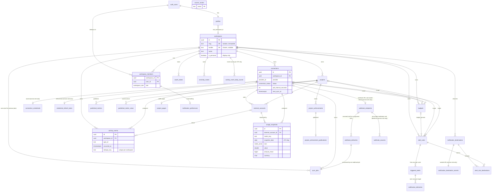

# Database schema

The schema lives in `supabase/migrations/`, forward-only:

| Migration | Contents |
|---|---|
| `20261031090000_tenancy.sql` | Roles, `profiles`, `workspaces`, `workspace_members`, `has_workspace_role`, `create_workspace`, sign-up trigger, last-owner rule, slug immutability |
| `20261031090100_integrations.sql` | `projects`, `connections`, `connection_credentials`, `oauth_states`, `external_accounts` |
| `20261031090200_metrics_events_alerts.sql` | `usage_snapshots`, `activity_events`, `budgets`, `alert_rules`, `triggered_alerts` |
| `20261031090300_jobs_and_invites.sql` | `pg_cron`, `pg_net`, `sync_jobs`, `claim_sync_jobs`, `access_invites`, `hook_before_user_created` |
| `20261031100000_sync_engine.sql` | One open sync per connection, `enqueue_sync_job`, `request_manual_sync`, `enqueue_due_syncs`, `latest_usage_resets`, and the retention purges for snapshots, events, and jobs |
| `20261031100100_oauth_state_pending_installation.sql` | `oauth_states.reconnect_connection_id` and `pending_installation_id` |
| `20261031100200_daily_summary_jobs.sql` | `daily_summary` jobs and `enqueue_daily_summaries` |
| `20261031100300_review_round_one.sql` | Drops `connection_credentials.access_expires_at` and `oauth_states.redirect_after` (never read); adds `purge_oauth_states` |
| `20261104090000_realtime_publication.sql` | Publishes `activity_events`, `usage_snapshots`, `connections`, and `triggered_alerts` to Supabase Realtime |
| `20261105002354_digitalocean_provider.sql` | `provider_id` gains `digitalocean` |
| `20261105002809_provider_posthog.sql` | `provider_id` gains `posthog` |
| `20261105002846_polar_provider.sql` | `provider_id` gains `polar`; `metric_kind` gains `recurring_revenue` for run rates such as MRR and ARR |
| `20261105002847_recurring_revenue_shape.sql` | Recreates `usage_snapshots_value_shape` (recurring revenue is money) and `usage_snapshots_spend_nonnegative` (recurring revenue is never negative, like spend) with the new kind |
| `20261105023129_published_metrics.sql` | `public_metric_id`, `published_metric_rounding`, `published_metrics`, and the publish, unpublish, and public read functions |
| `20261105120000_alert_delivery_job_kinds.sql` | `sync_job_kind` gains `alert_dispatch` and `digest` |
| `20261105120100_alert_delivery.sql` | `notification_preferences`, `notification_destinations`, `notification_destination_secrets`, `alert_rule_destinations`, `notification_deliveries`, and the delivery fields on `triggered_alerts` |
| `20261105120300_provider_sentry.sql` | `provider_id` gains `sentry` |
| `20261105120310_anomaly_detection.sql` | `workspaces.anomaly_detection_enabled` (on by default) and `anomaly_mutes`, the metrics a workspace muted from the unusual spend and usage checks |
| `20261105120320_api_keys.sql` | `api_keys`, `api_key_request_windows`, `authenticate_api_key`, `api_key_workspace`, and one `api_*` read function per REST endpoint |
| `20261105120400_railway_provider.sql` | `provider_id` gains `railway` |
| `20261105120500_project_pages.sql` | `project_pages` and the functions that turn a public project page on and off, find the page an address answers with, and list the sitemap's pages |
| `20261105120600_activity_event_counts.sql` | `activity_event_counts` for the trend event markers |
| `20261105120700_count_activity_events.sql` | `count_activity_events` (security invoker): activity event counts per connection and type in a half open window, for the dashboard headline |
| `20261105120800_provider_gitlab.sql` | `provider_id` gains `gitlab` |
| `20261105150000_public_share_surfaces.sql` | `share_surface`, `public_rate_limit_counters` and `bump_public_rate_limit`, `published_metric_views` and `record_published_metric_view`, and their retention purges |
| `20261106090000_activity_event_daily_counts.sql` | `activity_event_daily_counts`, the event count rollup kept by triggers on `activity_events`, and `rebuild_activity_event_daily_counts` with its backfill; `activity_event_counts` reads the rollup |
| `20261106144639_self_reported_metrics_limit.sql` | `publish_self_reported_metric` returns `limit_reached` for a 101st live self-reported value in a project |
| `20261107090000_timeline_connection_event_counts.sql` | `timeline_connection_event_counts`: events per connection under the timeline's filters, grouped by provider for the timeline's title badges |
| `20261110090000_timeline_title_search.sql` | `timeline_connection_event_counts` gains `p_title_pattern`, so the title badges count only events whose title matches the timeline's search |
| `20261111090000_workspace_handles.sql` | `workspaces.handle` with its format check and case-insensitive unique index, `set_workspace_handle` and `remove_workspace_handle`; `public_project_page` and `public_project_page_sitemap` gain the workspace's handle, and `public_project_page` finds a page by handle or slug |
| `20261111120000_year_review_slides.sql` | `year_review_event_counts` and `year_review_longest_run` for the year in review's slides, and `activity_events_workspace_type_time_idx` |
| `20261112090000_select_policies_membership_set.sql` | `current_user_workspace_ids`; every select policy compares `workspace_id` with it once per table reference in a statement (an InitPlan) instead of calling `has_workspace_role` per row |
| `20261112092000_filter_picker_options.sql` | `timeline_type_ids`, `snapshot_metric_options`, `snapshot_currencies`, and `snapshot_series_day_rows` for the filter pickers, behind one membership check each, and the internal `usage_snapshot_series_heads` |
| `20261112093000_headline_event_counts.sql` | `headline_event_counts`: the headline's signup and deploy counts per connection and type, summed from `activity_event_daily_counts` behind one membership check; drops `count_activity_events` |
| `20261112095000_usage_snapshot_monthly_latest.sql` | `usage_snapshot_monthly_latest`: each account's latest snapshot per metric, currency or unit, and UTC month, for the dashboard's monthly trend |
| `20261112095001_usage_snapshot_monthly_latest_lookup.sql` | `usage_snapshot_monthly_latest` finds each month's latest row with a hash aggregate and a unique key lookup instead of sorting whole rows |
| `20261112100900_headline_first_readings.sql` | `headline_first_readings`: every connection's oldest snapshot on or before a day, in one call behind one membership check; `usage_snapshots_connection_date_idx` on `(connection_id, snapshot_date)` replaces `usage_snapshots_connection_id_idx` |
| `20261112100901_latest_usage_resets_skip_scan.sql` | `latest_usage_resets` reads one row per metric of the account through the unique key instead of every snapshot of its history |
| `20261112100902_headline_first_readings_connection_probe.sql` | `headline_first_readings` leaves the workspace out of the snapshot lookup, so the planner keeps to `usage_snapshots_connection_date_idx` when the table's statistics are out of date |
| `20261112101200_super_admin_overview.sql` | Service role only figures for the super admin instance overview: `admin_instance_totals`, `admin_workspace_stats` (keyset pages, newest first, with `workspaces_created_at_id_idx`), `admin_provider_usage`, `admin_job_health`, `admin_job_failures`, and `admin_latest_migration` |
| `20261112212026_timeline_activity_buckets.sql` | `timeline_activity_buckets` (security invoker): how many events match the timeline's filters across all of its pages, in at most 12 equal slices of time, for the timeline's activity overview |
| `20261113100000_timeline_activity_bucket_severities.sql` | `timeline_activity_buckets` also returns `critical_events` and `warning_events` per slice, after its original columns, so the activity overview can stack severity in each bar |
| `20261114090000_activity_heatmap.sql` | `activity_heatmap` (security invoker): events per weekday and hour of day in a given time zone since a given instant, with the timeline's filters, for the dashboard's activity heatmap |
| `20261114120000_project_achievements.sql` | `project_achievements`, `project_achievement_publications`, `achievement_date_precision`, `achievement_evidence`, and the record, publish, unpublish, and public read functions for permanent project achievements |
| `20261115090000_webhook_job_kind.sql` | `sync_job_kind` gains `webhook` |
| `20261115090100_webhook_deliveries.sql` | `webhook_endpoints` (a per-connection webhook URL and its sealed secret), `webhook_deliveries` (each verified provider delivery, unique per provider and delivery id), `webhook_delivery_status`, `sync_jobs.webhook_delivery_id`, `external_accounts_external_id_idx`, and `record_webhook_delivery`, `list_webhook_targets`, and `purge_webhook_deliveries` |
| `20261115090200_webhook_delivery_review.sql` | `webhook_deliveries` unique per provider, endpoint, and delivery id (nulls not distinct); `record_webhook_delivery` stores an ignored delivery processed with no job; `list_webhook_targets` takes `failed` connections and returns `credential_updated_at`; `claim_sync_jobs` claims `webhook` jobs first |
| `20261115090300_webhook_claim_allowance.sql` | `claim_sync_jobs` claims every kind but `webhook` again, by `run_after` and id; `claim_webhook_jobs` claims `webhook` jobs on their own; `record_webhook_delivery` refuses an outcome whose `kind` is not `events`, `uninstalled`, or `ignored` |
| `20261116090000_connection_granted_at.sql` | `connections.granted_at`, when the connection was last granted (connect or reconnect, never a token refresh); `list_webhook_targets` also returns `granted_at` (the credential's last save for a live connection with no recorded grant), and keeps returning `credential_updated_at` until a later contract step, which first runs the backfill again, drops it |
| `20261116090100_connection_granted_at_backfill.sql` | `backfill_connection_granted_at` (service role only), batched and re-runnable, fills `granted_at` of every non-pending connection without one from its credential's last save, else from when it was created, and never overwrites a grant the app recorded meanwhile; the migration runs it until nothing is left |
| `20261116090200_webhook_uninstall_installation.sql` | `connections_provider_installation_idx` (partial, where `external_installation_id` is set); `record_webhook_delivery` refuses an `uninstalled` outcome that names neither a non-empty account nor a non-empty installation; `list_webhook_targets` gains `p_installation_id` (and `p_external_id` defaults to null) to match an uninstall naming an installation against `connections.external_installation_id` |
| `20261116090300_webhook_targets_grant_fallback.sql` | `list_webhook_targets` returns the credential's last save as `granted_at` for a live connection with no recorded grant, on the account and the installation match alike, as `20261116090000_connection_granted_at.sql` does for the three-parameter version |
| `20261116090400_backfill_granted_at_guard.sql` | `backfill_connection_granted_at` stated again with the body `20261116090100_connection_granted_at_backfill.sql` creates (its update repeats `granted_at is null`), for a database that applied the earlier body; a no-op anywhere else |
| `20261116120000_webhook_setup.sql` | `webhook_setup_mode`; `webhook_endpoints.setup_mode`, `provider_webhook_id` (set exactly for an automatic endpoint), and `awaiting_provider_secret` (manual only); `webhook_endpoints_enforce_limit`, at most 5 endpoints per workspace, serialized on the workspace row; `webhook_deliveries_endpoint_received_at_idx` replaces `webhook_deliveries_endpoint_id_idx` for the panel's last delivery; `oauth_states.webhook_setup`, set when the user chose automatic webhook setup |
| `20261116150000_webhook_sources.sql` | `webhook_sources` (service role only): per endpoint, each provider resource (a GitLab project) that holds a webhook StackDash created (`provider_webhook_id`), is still waiting for one, or has sent a delivery (`last_delivery_at`), keyed by `(endpoint_id, source_id)` and deleted with its endpoint; `webhook_sources_enforce_limit`, at most 100 per endpoint, serialized on the endpoint row; `webhook_endpoints.per_source`, an automatic endpoint whose webhooks are per source and so names none in `provider_webhook_id`; `record_webhook_source`, which keeps a delivery's source and the newest arrival; `save_created_webhook_source`, which records a webhook only where the source holds none and returns whether it wrote; `delete_webhook_endpoint`, which returns the endpoint's setup and its sources' webhooks and then deletes it, in one transaction serialized on the endpoint row |
| `20261116170000_credential_refresh_locks.sql` | `credential_refresh_locks` (service role only), one per connection: the refresh lock a sync and automatic webhook setup and removal take before refreshing a credential; `acquire_credential_refresh_lock` takes it for a lease of up to 600 seconds (StackDash asks for 60) and returns its id, or null while another holder's lease is current; the holder frees it by deleting the row with that id |
| `20261118090000_contract_webhook_targets.sql` | Contract step of `granted_at`: runs `backfill_connection_granted_at` again until it fills nothing, then `list_webhook_targets` drops `credential_updated_at` from its result and returns `granted_at` alone, without the credential fallback, on the account and the installation match |
| `20261118120000_insert_activity_events.sql` | `insert_activity_events` (service role only), how the job store writes sync, webhook, and daily summary events: inserts the events whose `(workspace_id, dedupe_key)` is new and returns how many, and sets `body` on a stored event only where it is null and the new row's is not, so a poll fills in what a webhook delivery could not carry and nothing else of a stored event changes. Within one call the first row of a key is the one written. `activity_events_count_rollup` is stated again with one change: an update that moves no event to another rollup key (a body fill-in) returns at once, so a fill-in takes no rollup lock and two writers filling the same event cannot deadlock on the rollup |
| `20261118130000_webhook_targets_installation_match.sql` | `list_webhook_targets` accepts `p_external_id` and `p_installation_id` together, and then keeps the account match to connections whose `external_installation_id` is that installation, so a Sentry issue delivery reaches only connections of the installation that sent it; a connection with no recorded installation is no match. Naming one of the two returns what it did before |
| `20261118140000_webhook_targets_simulated.sql` | `list_webhook_targets` also returns `simulated`, whether the target's connection was made by the provider simulator (`granted_scopes` holds `simulated:read`), as its last column, so the webhook job applies a delivery only to the kind of connection that verified it (recorded by the route in the stored outcome's `simulated`). Parameters, grants, matching, and the other columns are unchanged |
| `20261118150000_connection_mode.sql` | `connection_mode` (`live`, `test`); `connections.mode`, a connection's live or test mode for a provider that keeps both under one account id (Stripe), written when a grant completes and checked by every sync, so it lives outside the sealed credential; `list_webhook_targets` also returns `mode` as its last column, so the webhook job applies a delivery naming a mode only to connections of that mode. Parameters, grants, matching, and the other columns are unchanged |
| `20261118150100_connection_mode_backfill.sql` | `backfill_connection_mode` (service role only), batched and re-runnable, fills `mode` of every non-pending Stripe connection without one from its `authorized_account_label` (only the shapes the adapters write: `Stripe account <id> (test mode)` and `Example Stripe account (test mode)` are test, `Stripe account <id>` is live, and any other label keeps null, which the next sync fills from the credential), and never overwrites a recorded mode; the migration runs it until nothing is left |
| `20261118150200_contract_connection_mode.sql` | Contract step of `connections.mode`: runs `backfill_connection_mode` again until it fills nothing, then adds `connections_stripe_mode_required` (`provider <> 'stripe' or status = 'pending' or mode is not null`) `not valid`, so from then on no insert or update leaves a Stripe connection past pending without a mode |
| `20261118150300_contract_connection_mode_validate.sql` | Runs `backfill_connection_mode` a last time and drops it, stops with the count while any Stripe connection past pending still has no mode (the remedy is in `docs/operations/self-hosting.md`), then validates `connections_stripe_mode_required`, so every Stripe connection past pending has a mode |
| `20261122210934_live_refresh_broadcast.sql` | Expand step of live refresh through Broadcast: `broadcast_live_change` and an after insert and an after update statement trigger on each of `activity_events`, `usage_snapshots`, `connections`, and `triggered_alerts`, which send one private Broadcast message per statement and workspace on `workspace-live:<workspace id>`; the `workspace_live_select` policy on `realtime.messages`, which lets a workspace's members receive its topic and no client send on any private topic (see [Realtime](#realtime)) |
| `20261123085405_live_refresh_broadcast_contract.sql` | Contract step of live refresh through Broadcast, at least one release after the expand step: takes `activity_events`, `usage_snapshots`, `connections`, and `triggered_alerts` out of the `supabase_realtime` publication, which then publishes no table (see [Realtime](#realtime)) |

`supabase/seed.sql` loads synthetic local data: two invited users, each with a personal workspace, sharing the workspace Acme (one owner, one viewer) with one project, one `fake` connection, three days of snapshots, and a few events. Its header lists the fixed UUIDs tests can use.

## Entity relationships

What each of these is for, and how workspaces, connections, external accounts, and projects fit together: [Workspaces, connections, accounts, and projects](concepts.md).



`access_invites` stands alone: the before-user-created hook reads it to admit an invited email.

References between two tenant rows are composite foreign keys on `(workspace_id, x_id)`, so the database refuses a budget, rule, mapping, or snapshot that points at another workspace's row even if a caller learns its UUID.

## Roles and row level security

Every table in `public` has RLS enabled. Policies read the caller's role from `workspace_members` at query time (never from JWT claims), so a role change applies on the next request. Ranks: viewer 1, admin 2, owner 3. Two helpers answer only for the caller:

- Select policies check `workspace_id = any (array(select public.current_user_workspace_ids(min_role)))`: the caller's workspaces at that rank or above, read once per table reference in a statement (an InitPlan in `explain`; a read that joins three workspace tables does three short lookups), so a filtered read over a large table costs one membership lookup, not one per row. A new select policy follows the same shape; a database test fails on any select policy that calls `has_workspace_role`.
- Insert, update, and delete policies call `public.has_workspace_role(workspace_id, min_role)` on the rows they write.

| Table | Read | Write through the Data API |
|---|---|---|
| `workspaces` | viewer | rename and turn the unusual spend and usage checks on or off: admin; delete: owner; create: only `create_workspace` (service role); handle: only `set_workspace_handle` and `remove_workspace_handle` (service role, after an owner or admin check) |
| `workspace_members` | viewer | owner manages any row; admin manages non-owner rows; only an owner grants `owner` |
| `projects`, `connections`, `external_accounts`, `budgets`, `alert_rules`, `alert_rule_destinations` | viewer | admin |
| `anomaly_mutes` | viewer | admin adds and removes; never updated |
| `usage_snapshots`, `activity_events`, `sync_jobs` | viewer | none (service role) |
| `activity_event_daily_counts` | viewer | none, not even the service role: only the `activity_events` triggers and `rebuild_activity_event_daily_counts` (service role) write it |
| `published_metrics`, `project_pages` | viewer | none (service role functions, after an owner or admin check) |
| `project_achievements`, `project_achievement_publications` | viewer | none (service role functions; publishing after an owner or admin check) |
| `published_metric_views` | viewer | none (service role function) |
| `public_rate_limit_counters` | none | none (service role function) |
| `triggered_alerts` | viewer | admin acknowledges (`acknowledged_at`, `acknowledged_by` only, in their own name) |
| `notification_preferences` | own row | own row, owner or admin only (viewers receive no alert email) |
| `notification_destinations` | viewer | admin renames, chooses rules and digest, and deletes; created only through `create_notification_destination` (service role); status and errors are server written |
| `profiles` | own row | own row |
| `connection_credentials`, `credential_refresh_locks`, `oauth_states`, `access_invites`, `notification_destination_secrets`, `notification_deliveries`, `webhook_endpoints`, `webhook_deliveries`, `webhook_sources` | none | none (service role; the auth hook reads invites) |
| `api_keys` | admin, every column but `token_hash` | admin creates keys and revokes them (`revoked_at` only, final) |
| `api_key_request_windows` | none | none (service role) |

Defense in depth, following BackTalk's hardening:

- Table privileges are revoked from `anon` and `authenticated`, then `authenticated` gets `select` plus only the columns the app writes. Identity, tenancy, provenance, and audit columns are never writable through the Data API. `created_by` and `updated_by` default to `auth.uid()`, and a trigger sets `updated_by` on every signed-in update.
- Every function revokes `execute` from `public` and `anon`; `security definer` functions pin `search_path = ''`, and the authorization helpers only ever answer for the caller.
- The database keeps at least one owner per workspace: a deferred constraint trigger on `workspace_members` rejects the commit otherwise. Deleting a user first deletes workspaces where they are the only member; a shared workspace where they are the only owner blocks the deletion until ownership moves.
- `is_personal` is display only. Nothing authorizes on it.

The app mirrors this matrix in one server-side guard (`canPerform`) so users get a clear reason; RLS stays the backstop.

## Workspaces and sign-up

`public.create_workspace(user_id, name, is_personal)` is the only way to create a workspace. It writes the workspace and the owner membership in one transaction. A partial unique index allows one personal workspace per user, and the function returns the existing one on a repeat call, so sign-up is idempotent. The `on_auth_user_created` trigger on `auth.users` creates the profile (display name from GitHub's `user_name`, else `name`) and the personal workspace, and points `profiles.last_workspace_id` at it.

Slugs are 10 random lowercase base32 characters, never derived from the name, and a trigger rejects any change, so renaming never breaks a URL.

## Invite-only sign-up

`public.hook_before_user_created(event jsonb)` returns `{}` when `lower(event.user.email)` is in `access_invites` and a 403 error object otherwise. Supabase Auth calls it for every user creation, including GitHub OAuth and the admin API, so test fixtures add their emails to `access_invites` first, as the seed does. Enable it in `supabase/config.toml` under `[auth.hook.before_user_created]` with `uri = "pg-functions://postgres/public/hook_before_user_created"`.

## Why snapshots double as current metrics

`usage_snapshots` holds one row per external account, metric key, and UTC day. Every sync upserts today's row, so the row for the latest `snapshot_date` per `(external_account_id, metric_key)` is the current value, and earlier rows are the daily history for charts. One table means:

- No second "current metrics" table to keep in step with history, and no window where the dashboard and the chart disagree.
- The unique key `(external_account_id, metric_key, snapshot_date)` makes a sync retry harmless: the last value of the day wins.
- The dashboard reads the newest row with an index scan on that key; the workspace history reads `(workspace_id, snapshot_date desc)`; a connection's oldest row is the first entry of `(connection_id, snapshot_date)`.
- Before each sync writes, `latest_usage_resets(workspace_id, account_id)` reads the reset time on the newest row of each metric of the account, so a billing period rollover raises one `stackdash.allowance_reset` event. It steps through the account's metric keys on the unique key, two index probes per metric, so it reads the same few rows however much history the account has.

Each row keeps the adapter metric model: kind, value and unit or integer minor units and currency (never both), a period or a point in time, provenance, pricing source for estimates, and `retrieved_at`. Totals are only ever computed per currency.

The dashboard's headline strip reads the same daily rows as running totals: a day's revenue or spend is the change in a billing period total since the previous day's reading, so a week or month window does not depend on any provider's billing period. A change that spans a window edge cannot be split, so the provider is shown as unavailable for that window instead of counting part of it. Two kinds of row are not running totals and are left out: a total read after its period ended (DigitalOcean's last invoice, a day's estimated spend read the next day), as `isCurrentPeriod` leaves it out of current values, and a projection for the whole period, on every day it is read. Projections are declared by each adapter in `ProviderAdapter.projectedSpend`, not guessed from the period, because on a period's last day a projection and a total so far look the same: PostHog's `posthog.spend.projected`, Railway's `railway.estimate.bill`, and the Example provider's `fake.cost.estimate`. A new adapter whose estimate is a projection declares it there. The rules and their tests are in `src/lib/dashboard/headline.ts`. The same declaration, through the same rule (`isDeclaredProjection` in `src/lib/dashboard/aggregate.ts`, applied by `countedSnapshots`), keeps projections out of every other reading of spend too: the dashboard's totals, provider cards, and project spend, digests, spend and budget alerts, the unusual spend and usage checks (`checkedRows` in `src/lib/alerts/anomaly.ts`), the dashboard's own projections, and the daily summary.

The strip reads its rows on its own (`getHeadlineSnapshots` in `src/lib/data/headline.ts`), not from the trend history: only the money kinds and the declared daily signup totals, from the day before the previous window to today, so the allowance and usage rows that make up most of a workspace's history do not count toward the read cap. The cap is still 10,000 rows per read, newest first; past it the oldest days are left out, the providers are named unavailable for the previous window, and the figures lose their comparison, with a `dashboard.snapshots_truncated` warning in the log and the page's notice (see [Capped dashboard reads](#capped-dashboard-reads)).

When no figure can be reported for the window to date because a connection in view has not synced since the window's last required day began (stale), the strip shows the last complete week or month instead (`fallbackWindows` in `src/lib/dashboard/headline.ts`): the newest whole one that ended before the day of the newest of those stale syncs, compared with the whole one before it, labeled with its dates. Only then does the page make a second round of the same two reads for those windows, because which windows to read depends on the first. When that window has no figure either, one explanation replaces the six figures. A strip with no figure and no stale connection (providers that report none of its kinds, or a connection too new) keeps its per-figure reasons and makes no second read.

Signups and deploys in that strip come from `public.headline_event_counts(workspace_id, account_ids, type_ids, start, end)`: counts per connection and event type over the window's UTC days, both ends inclusive, for the accounts the scope filter leaves in view. It sums the daily event rollup (`activity_event_daily_counts`, below), whose day is the UTC day of `occurred_at`, so a window of whole UTC days counts exactly the events in it, and each count takes its connection from the account it is keyed by. It is `security definer` behind one `has_workspace_role` viewer check, so a non-member counts nothing, instead of `security invoker` with the `activity_events` select policy run on every scanned event: measured on the local stack with `explain (analyze, buffers)`, a month window over 1,000,000 synthetic events went from 326 ms to 0.6 ms. Select policies now read membership once per table reference, not per row (`20261112090000_select_policies_membership_set.sql`), so that comparison no longer holds; the definer shape now rests on the one check before any row is read and on reading the rollup instead of the events.

Each connection's first reading, which decides whether the connection could have counted a window's events at all, comes from `public.headline_first_readings(workspace_id, account_ids, on_or_before)` in the same round of reads: the oldest `snapshot_date` on or before the current window's first day per connection, over the accounts in view, in one call however many connections are in view. It walks `(connection_id, snapshot_date)` from each connection's oldest row, behind the same single `has_workspace_role` viewer check. On 46,200 synthetic rows across ten connections that started a month apart it takes about 0.2 ms for all ten; the one request per connection it replaced scanned the workspace's history from its oldest day, 6.4 ms for the newest connection alone.

The accounts in view are a filter on that walk, not part of the index. When a connection's oldest row belongs to an account in view, its read is one index probe. Otherwise the read first skips the connection's older rows of the accounts out of view: a connection with a year of one account's history, read for a second account that joined it six weeks earlier, reads about 6,500 buffers (0.8 ms). That is bounded by one connection's history, where the request it replaced was bounded by the workspace's. The lookup does not filter on `workspace_id`, because the accounts are the workspace's and each snapshot's foreign key to its account keeps every row read inside the workspace. With that filter the planner could pick the workspace index whenever the table's statistics were out of date, which on the same rows took 18 to 27 ms a call instead of 0.3 ms.

Which event types count is declared by each adapter, not listed in the strip: an event type whose declaration sets `category` to `signup`, `deploy_succeeded`, or `deploy_failed` (`EventTypeSchema` in `src/lib/adapters/events.ts`) counts as a signup or a deploy. A new adapter sets it on its own signup and deploy event types and needs nothing else. Railway counts `railway.deployment.deployed` and `railway.deployment.failed`. Its building, crashed, and removed events are not counted: a build starting says nothing about how the deployment ended, and a crash or a removal usually comes after a deployment already counted, so counting them would count it twice. The cost is that a Railway deployment that succeeded and was replaced before any poll saw it is not counted ([Railway](../providers/railway.md#limitations)). A Sentry release is not a deployment and is not counted. Whether a connection had reported by a window's first day comes from its oldest snapshot, read on its own by `headline_first_readings` (above), rather than from a capped snapshot read.

A daily summary event (`supabase.auth.daily_summary`, `posthog.signups.daily`) has no category, because the strip counts events and one summary is not one signup. A provider that reports signups only as a total per UTC day declares the `usage` metric holding it in `ProviderAdapter.signupDailyTotals` (PostHog: `posthog.signups.daily`), and the strip sums that metric's daily rows instead: one row per whole UTC day, its period exactly that day. A day's total exists only once the day has ended, so such a provider counts the current window up to yesterday and the previous window over as many days, and says so on the signups figure and in the cost per signup explanation. Every one of those days needs a row, or the provider is named unavailable for the window: on a window's first day, and after a day its sync missed.

## Jobs

`sync_jobs` is a queue with two claims, both with `for update skip locked`, so overlapping ticks never run a job twice: `claim_webhook_jobs(limit, lease_seconds)` takes `webhook` jobs and `claim_sync_jobs(limit, lease_seconds)` every other kind, each ordered by `run_after` and id. A tick calls both with separate limits, so a backlog of one kind never takes the other's share. A running job whose lease expired is claimable again until it uses `max_attempts`. `pg_cron` and `pg_net` are installed by migration; the per-minute call to `POST /api/jobs/tick` carries the deployment URL and `CRON_SECRET`, so it is registered per environment, not in a migration.

Provider webhooks use the same queue. The webhook route verifies a delivery and calls `record_webhook_delivery`, which stores it in `webhook_deliveries` and queues one `webhook` job naming it (`sync_jobs.webhook_delivery_id`, set exactly when the kind is `webhook`) in one transaction. It refuses an outcome whose `kind` is not `events`, `uninstalled`, or `ignored`, so a received delivery always has its job, and an `uninstalled` outcome that names neither a non-empty account (`externalAccountId`, with `by` absent or `account`) nor a non-empty installation (`by` = `installation` and `installationId`). A delivery whose outcome is `ignored` is stored already processed, with no outcome and no job. A delivery whose (provider, endpoint, delivery id) is already stored returns false and queues nothing, so a provider's retry is acknowledged and dropped; an app-level delivery has no endpoint, and nulls are not distinct, so its id is unique per provider. The endpoint is part of the key because a provider sends one message id to every endpoint of an account. The job is instance-wide: an app-level delivery can reach several workspaces, and `list_webhook_targets` finds them, at most 100, on active, `failed`, or `needs_attention` connections of the provider, and only on the endpoint's own connection for a per-connection URL. It takes `p_external_id`, `p_installation_id`, or both together (since `20261118130000_webhook_targets_installation_match.sql`), and refuses a call naming neither. Given only `p_external_id`, it returns each included external account with that external id; given only `p_installation_id`, each connection whose `external_installation_id` is that installation, with a null account, through `connections_provider_installation_idx`; given both, the `p_external_id` match kept to connections whose `external_installation_id` is that installation, so a connection with no recorded installation is no match. The app writes `external_installation_id` when a grant completes, from the adapter's `installationIdOf`, and fills it on the next sync of a connection that has none: the installation id lives in the sealed credential metadata, so SQL cannot backfill it. Every target carries the connection's `granted_at`: when it was last granted, by a connect or a reconnect. The app writes it as a grant completes (`completeConnection`); a token refresh saves only the credential and never moves it, so an uninstall older than a reconnect is left to the next sync while one older than only a refresh is applied. Connections granted before the app wrote it were filled by `backfill_connection_granted_at`, from the credential's last save or else when the connection was created, and every uninstall applies to a live connection whose `granted_at` is null. That is one inserted as live after the migrations ran (the seed and the e2e fixtures set it for that reason; pgTAP fixtures outside 31 to 33 and 38 and `MemoryJobStore.addConnection` leave it null on purpose), or one a build from before `granted_at` made while it served after `20261118090000_contract_webhook_targets.sql` ran: a self-hosted upgrade that applies both halves in one `supabase migration up` before it promotes, or an Instant Rollback to such a build. For the second, once the current build serves again, run `backfill_connection_granted_at(1000)` as the service role until it returns 0; it never overwrites a recorded grant. Every target also carries `simulated`: whether the provider simulator made its connection (`granted_scopes` holds `simulated:read`, the marker `isSimulatedConnection` reads). The route records in the stored outcome's JSON whether the provider's simulated twin verified the delivery (`simulated`, a boolean; no column), and the job applies a delivery the twin verified to simulated connections only and any other to real connections only. An outcome stored without it, by a build from before that, reaches no connection. Every target also carries `mode`: `connections.mode`, the connection's live or test mode, null for every provider but Stripe. The route records in the stored outcome the mode an events or uninstall delivery names (`mode`, Stripe's from the event's `livemode`), and the job keeps only the targets of that mode, after the kind filter; a delivery that names no mode keeps every target. Every Stripe target has a mode: `connections_stripe_mode_required` (since `20261118150200_contract_connection_mode.sql`, validated by `20261118150300_contract_connection_mode_validate.sql`) refuses a Stripe connection past pending without one, and `list_webhook_targets` never returns a pending connection. Once processed, a delivery keeps only its key; its outcome is cleared. A per-connection secret in `webhook_endpoints` is AES-256-GCM ciphertext sealed by the app like connection credentials, with associated data `webhook_endpoint:<workspace id>:<connection id>`.

## Realtime

An open workspace page updates when a sync writes to the tables its screens read: the database sends a Broadcast message, and the page reads again. The screens also read tables that people edit in the app (`external_accounts`, `projects`, `budgets`, `alert_rules`, `anomaly_mutes`) and `workspace_members`; none of them sends one. The Server Function that edits one of those tables calls `refresh()` itself, so the page that made the change reads again. A sync writes only `external_accounts.sync_cursor` among them, which no screen shows, so do not make them send messages to make a screen live.

| Table | What a change to it refreshes |
|---|---|
| `activity_events` | New events on the timeline and the dashboard |
| `usage_snapshots` | Spend, revenue, recurring revenue, usage, and allowances on the dashboard and its trends |
| `connections` | Sync status, last synced time, and errors on the connection pages and the dashboard, and the connection count and list in the header's live indicator |
| `triggered_alerts` | The alerts page and the dashboard alerts summary |

Each of these tables has an after insert and an after update statement level trigger that runs `broadcast_live_change`. For each workspace a statement wrote, it sends one message with `realtime.send` on the private topic `workspace-live:<workspace id>`, whatever the statement's row count: a sync that inserts 25,000 events sends one. The event is `change`, and the payload names the table, the operation (`INSERT` or `UPDATE`), `connection_ids`, and `changed_at`, plus the message id `realtime.send` adds, and carries no row data. `connection_ids` are the connections the statement brought provider data from: the connection of every usage snapshot, and of every activity event with a provider. `changed_at` is the start of the write's transaction, the time its rows' `created_at` and `updated_at` take. An upsert sends one message for the rows it inserted and one for those it updated, a statement that writes no row sends nothing, and deletes send nothing, because no screen listens for them. The function is security definer, so the message is written whoever wrote the rows. `realtime.send` stores it in `realtime.messages`, whose daily partitions Realtime drops after three days, and Realtime streams it from the write-ahead log to the topic's subscribers through a replication connection of its own; an insert that fails becomes a warning and never fails the write.

The `workspace_live_select` policy on `realtime.messages` lets a signed-in user receive a `workspace-live` topic only while they are a member of that workspace, at any role (`current_user_workspace_ids`). Realtime checks it when a channel joins and again whenever the client sends a new access token or the token expires. So a member removed from a workspace keeps receiving its messages, which carry no row data, until their access token is refreshed or expires: at most one hour, the access token's lifetime (`jwt_expiry` in `supabase/config.toml`, and Supabase's default). There is no insert policy, so no client can send a broadcast or track presence on a private topic.

Postgres Changes is not used, and the `supabase_realtime` publication publishes no table: the four tables stayed in it for one release after the expand step, so a rollback to the build before it kept live refresh, and `20261123085405_live_refresh_broadcast_contract.sql` took them out. A build without `20261122210934_live_refresh_broadcast.sql` listens to Postgres Changes on them, so after a rollback to one its pages update only on navigation or reload; no data is lost. `supabase/tests/database/07_realtime_publication.test.sql` fails if a migration publishes a table, above all `connection_credentials`, `oauth_states`, `access_invites`, or `profiles`. A table that Postgres Changes listens to sends every row a statement writes to every subscriber of the workspace, and Realtime checks each row against every subscription to its table, so one bulk write could reach the project's message limit, after which Realtime skips every change for every subscriber in the project for about a minute.

`src/components/app/live-refresh.tsx`, mounted once in the workspace layout, loads the user's access token (`supabase.realtime.setAuth()`), joins the workspace's topic as a private channel, and calls `router.refresh()` on each message so the Server Components read again. Refreshes are debounced in `src/lib/realtime/refresh-scheduler.ts`: one 750 ms after the last change, and at least one every 3 s while changes keep arriving, so a sync writing to several tables refreshes once or twice rather than once per statement. A hidden tab refreshes once when it is shown again, and so does the timeline once its event details close: while they are open the URL names an event the router has not rendered, and a refresh then would leave Next.js unable to render the page that closing goes back to (`holdLiveRefresh` in `live-refresh.tsx`, held by `src/components/timeline/event-inspector.tsx`). No row data is kept in the browser, except the ids of the connections a change brought provider data from, which the live indicator needs to say which connection is receiving. The channel is removed when the layout unmounts. Every mount of a workspace joins the same topic, and removing a channel takes it out of the client's list at once, so a mount that follows straight after gets a new channel. The channel asks Realtime to confirm when the stream that carries the database's messages is up (`replication_ready`). If it is not up within a minute, Realtime closes the channel. After any close, LiveRefresh shows offline, logs the reason Realtime sent, and joins again 10 s later. A change written while the channel was down is never delivered, so once a later join's stream is up, LiveRefresh refreshes once.

Arriving data is marked so a refresh is visible. `src/components/app/arrivals.tsx` wraps the workspace layout: the components that show data keep what they rendered last time (event ids on the timeline and each provider's event count in its chips, values by account and metric key on the dashboard, today's trend point) and compare it with the refreshed render, so only what changed is marked; the rules are in `src/lib/realtime/arrivals.ts`. A change is marked only when a batch arrived while the component was in view. A change of path, filters, page, or trend period resets the comparison (the timeline's provider chips ignore the page, because their counts span every page: their `ArrivalScope` in `src/app/w/[workspace]/timeline/page.tsx` leaves the cursor out), and so does leaving a page: with Cache Components, Next.js keeps recent pages mounted but hidden in React `<Activity>` and shows them again on return, so each component registers itself as in view from a layout effect, which hiding cleans up. A first load, a navigation, or a return to a page whose data changed while it was hidden never animates. A new event slides in with a severity-colored edge, a changed card pulses once and shows "Updated", its numbers count from the old value, a usage bar resizes, today's trend point draws in and pings, and a timeline provider chip whose count grew glows with the changed card's coral pulse, all with the landing page keyframes in `src/app/globals.css`, each a second or less, using only properties that do not change layout. Under `prefers-reduced-motion: reduce` each becomes a static highlight that clears after 4 s. One polite live region per workspace says what a refresh brought ("3 new events. Spend in USD updated."). The live indicator in the header reads "Connecting", "Live", or "Offline" (its accessible name always starts "Live updates"). While live its dot breathes a slow ring; when a batch arrives it flashes coral and ripples instead. Under reduced motion neither moves, and the dot holds the coral for 4 s after an arrival instead. It shows how many connections are active from `lg`, and a warning mark from `sm` when one needs attention or failed. On hover and focus it shows when the newest change was written and lists the workspace's connections with their status, problems first and at most eight; disconnected connections are left out. A connection a batch brought provider data from (the `connection_id` of a usage snapshot, or of an activity event with a provider, which the change's message names) says "Receiving" under its name in that list for 4 s after the last such batch. A change to the `connections` row itself, or StackDash's own sync-failed event, does not count: neither is data received from the connection. The header reads them through the request-cached `getWorkspaceScope`, so a sync that changes a connection's status updates the count on the next refresh.

## Capped dashboard reads

The dashboard's snapshots reach three parts of the page through reads capped at 10,000 rows each, newest first: the cards' 45 days (`loadDashboardSnapshots` in `src/lib/data/dashboard.ts`), which the daily trend shares; the headline's two reads, one of money rows and one of daily signup totals (`getHeadlineSnapshots` in `src/lib/data/headline.ts`), and two more when the page also reads the last complete window; and the monthly trend's rollup (below). Each read has its own cap, so the headline's money and signup rows are 10,000 each, not 10,000 together. With a daily row for each, the cards' read is the first to stop, past about 222 account and metric pairs, and then an account whose newest row is older than what the read reached drops out of the cards. A read that stops at the cap cannot tell whether it read its oldest day whole, so it is whole only from the day after (`completeFrom` on `SnapshotRead`). A trend chart is whole from the first of its days or months the read holds whole (`trendCompleteFrom` in `src/lib/dashboard/trends.ts`, called once by `getTrendData` in `src/lib/data/trends.ts`): the daily trend is named only when that day falls inside its 30 days, and the monthly trend is whole from the first day of the month after its partly read oldest month. The headline, which reads more than once, is whole from the latest of its reads' days.

The page shows one notice for every capped read, laid out like the stale notice, instead of a line on every card (`capNotice` and `capNoticeText` in `src/lib/dashboard/aggregate.ts`, `CapNotice` in `src/components/dashboard/cap-notice.tsx`): which parts leave out older readings (the headline, the cards, the daily or the monthly trend) and the UTC date from which each is whole, beside the `dashboard.snapshots_truncated` warning in the log. The monthly trend's read streams in behind its own Suspense boundary, so its part joins the notice when that read resolves, inside a polite live region (`role="status"`) that stays mounted. Whether a screen reader announces it there has not been checked with one.

## Monthly trend

The dashboard's monthly trend sums, per series and UTC month, each account's latest row of the month, and expects an account from the first month it reported (`buildTrends` in `src/lib/dashboard/trends.ts`). An account with no row in the dashboard's 45 day window has stopped reporting, and both trend views expect it only up to the day or month of its last row, so it does not make a later month unavailable. The comparison across that last month then compares a sum that includes the account with one that does not, so it can show a fall that is only the account leaving. Every other row of a month changes nothing it shows, so `public.usage_snapshot_monthly_latest(workspace_id, since)` returns only those rows: one per account, metric, currency or unit, and UTC month from `since`, as whole `usage_snapshots` rows. An account's latest row of its last month is also its last row, so the read keeps the date that decides whether it stopped reporting. The read grows with months instead of days. Reading every daily row stopped at the 10,000 row cap, newest first, so a workspace with a long history showed its oldest months as unavailable. The rollup is capped at 10,000 rows as well, which it reaches past about 770 account and metric pairs; then the page's notice names the monthly trend and its first whole month (see [Capped dashboard reads](#capped-dashboard-reads)). The function is `security definer` and checks membership once before reading any row, so a non-member reads nothing. PostgREST orders a function's rows only by selected columns, so `loadMonthlySnapshots` in `src/lib/data/dashboard.ts` selects `id` for its tiebreak. The daily trend still reuses the dashboard's 45 days of rows.

## Trend event markers

The dashboard trend charts mark how many deployments, payments, signups, star events, and triggered alerts happened in each UTC day or month. PostgREST cannot group rows, so `public.activity_event_counts(workspace_id, since, bucket, type_ids, providers, account_ids)` counts them: one row per UTC day or UTC month (`bucket` is `day` or `month`), provider, and type id with events, from the first UTC instant of `since`, with `bucket_start` the bucket's first day. Grouping by month in the database keeps the monthly chart's result to one PostgREST response. It is `security definer` and checks membership once before reading any row, so a non-member counts nothing; as `security invoker` the `activity_events` select policy ran `has_workspace_role` once per scanned row, which `explain (analyze, buffers)` on 2.3 million events showed was most of the cost. That per row cost is gone now that select policies read membership once per table reference, so the definer shape now rests on the single up-front check, not on avoiding the policy. It now sums `activity_event_daily_counts` instead of reading events: one row per workspace, UTC day, type id, provider, and external account, kept equal to `activity_events` in the same transaction by statement level triggers on insert, update, delete, and truncate. Every writer, the retention purge, and the foreign key actions (cascades from workspaces and connections, `set null` from external accounts) therefore keep it current without knowing it exists, and an insert skipped by a dedupe conflict counts nothing. `rebuild_activity_event_daily_counts(workspace_id)` (service role) recounts one workspace from its events and can run again at any time; the migration runs it for every workspace as the backfill. Over 2.3 million synthetic events in one workspace, 13 months went from 763 ms to 1.7 ms and 30 days from 55 ms to 0.7 ms, as a member, with `explain (analyze, buffers)`; `supabase/tests/database/20_activity_event_daily_counts.test.sql` proves the rollup equals the raw events after each kind of change. Only `authenticated` may call it: the migration revokes the execute that Supabase's default privileges give `anon` and `service_role` on every new function, and the pgTAP shape check pins both. The provider and account filters behave like the timeline's: an empty provider list or a null account list means any, and otherwise events with no provider or no account (StackDash's own events) are left out, so a marker counts exactly what its timeline link lists. `src/lib/dashboard/markers.ts` lists which type ids form each category and records why similar events stay out. Its unit test fails if an id is not declared by an adapter, and it lists the adapters by provider id, so a new provider without an entry fails the typecheck until someone decides which of its events are markers.

## Timeline provider badges

In the title row, the timeline shows a chip for each provider with events in view: its logo, its name, and how many of its events match across every page. How many of its connections are in view is part of the chip's accessible name, not printed. Each chip links to the timeline filtered to that provider. A chip glows when its count grows in a live refresh, a provider's first event in view included, and a falling count glows nothing (`ArrivalProviderChips` in `src/components/timeline/arrival-events.tsx`; see Realtime). `public.timeline_connection_event_counts(workspace_id, type_ids, hidden_type_ids, severities, providers, account_ids, from, until, title_pattern)` counts the events: one row per connection, with its provider and display name. The app selects only the provider and the count, and `providerBadges` in `src/lib/timeline/provider-badges.ts` groups them by provider. Every argument but the workspace has a default that means no filter, and the filters match `listTimelineEvents` in `src/lib/data/timeline.ts`. An empty array means any value, except `hidden_type_ids`, which always excludes what it lists. A null `account_ids` means any account, and an empty one means none. The `from` and `until` window is half open. `title_pattern` is the timeline's title search as a case insensitive regular expression (`~*`) built by `titleSearchPattern` in `src/lib/timeline/query.ts`, with every metacharacter escaped so the search matches literally; the list sends the same pattern to PostgREST's `imatch`, so a badge counts exactly what the list shows, and null means no search. The provider filter matches the event's provider, as the list does. So with a provider filter, a StackDash event about a connection (provider null, such as `stackdash.sync_failed`) drops out, as it does from the list. Events with no connection, such as daily summaries, belong to no badge. The list's cursor does not apply, so an older page shows the same counts. Like `activity_event_counts`, it is `security definer`, checks membership once with `has_workspace_role` before reading any row, and is executable by `authenticated` only. As `security invoker`, the per row select policies took 427 ms for 22,975 events on the local stack; behind the single check it takes 5.5 ms. Select policies now read membership once per table reference, so that comparison no longer holds (the timeline's own filtered list, which reads through the policy, now takes 2 to 70 ms over about 25,000 events); the definer shape stays for the single up-front check. It reads the live table because the rollup has neither `connection_id` nor `severity`. With no filter at 2.3 million events in one workspace, it takes 134 to 148 ms. That is accepted for now, and serving it from a rollup is planned. `supabase/tests/database/21_timeline_connection_event_counts.test.sql` covers each filter, the title pattern included, the window edges, a non-member, and a member of two workspaces.

## Timeline activity overview

Above the feed, the timeline charts how many events match its filters across every page, in at most 12 bars. PostgREST cannot group rows, so `public.timeline_activity_buckets(workspace_id, type_ids, hidden_type_ids, severities, providers, account_ids, from, until, title_pattern)` counts them: one row per slice of time, `(bucket_start, bucket_end, events, critical_events, warning_events)`, with `bucket_start` inclusive and `bucket_end` exclusive. `critical_events` and `warning_events` count how many of the slice's `events` have that severity, under the same filters, so a severity filter of `info` returns 0 for both. They were added after the first three columns (`20261113100000_timeline_activity_bucket_severities.sql`), so a caller that selects the original columns by name is unaffected. Its arguments, defaults, and filters are the badges' above, so the bars add up to what the list shows over all of its pages. Unlike the badges, events with no connection, such as daily summaries, count, because the list shows them. `listTimelineActivity` in `src/lib/data/timeline.ts` calls it, and `ActivityOverview` in `src/components/timeline/activity-overview.tsx` draws each slice as a link to the timeline narrowed to it, with its critical and warning events stacked inside the bar.

- Bounds: `from` and `until` when given. A missing bound comes from the matching events: the earliest `occurred_at` floored to its UTC hour, or the latest floored to its UTC hour plus one hour, so the latest event falls inside the half open range. A missing bound with no matching event returns no rows, and both bounds given with no matching event return every slice with 0. Bounds out of order or equal return no rows.
- Width: every slice is `ceil(span in seconds / 12 / 60)` minutes wide, and at least one minute, so there are at most 12. Slices are counted in UTC seconds, never local days, so a clock change in Europe/London does not stretch or shrink one. The last slice ends at the upper bound, so it can be narrower. The slice of an event is worked out in whole microseconds, so an event one microsecond before a boundary never rounds into the next slice.
- The app passes the timeline's date filter as the window (`from` and `to`, whole London days, through `occurredRange` in `src/lib/timeline/query.ts`), never the selected bar (`start` and `until`). The list and the badges narrow to the selection through `timelineOccurredRange`, and the chart keeps its full context, so another bar can be chosen without clearing the first.

It is `security invoker`, unlike the badges and `activity_event_counts`. It calls `has_workspace_role` for a viewer before working out any bound, so a non-member gets no rows, not even the zero slices that explicit bounds alone would produce, and the `activity_events` select policy still applies to every row read as a second guard. The badges were made `security definer` because the select policy then called `has_workspace_role` on every scanned row (427 ms against 5.5 ms, above), and they stay definer only for their single up-front check. This function came after `20261112090000_select_policies_membership_set.sql` made the policy read membership once per table reference, so it has no per row cost to avoid and keeps the policy in force instead of bypassing it. Every call is planned for its own arguments (`plan_cache_mode = force_custom_plan`), as the badges are, so a window or account filter can become a range scan of `activity_events_workspace_timeline_idx`. The matching events are read once into a materialized list of timestamps: the missing bounds are its minimum and maximum, and the counts are one grouped pass over it, so nothing is scanned once per slice. With no window it reads every event the workspace keeps, as the unfiltered badges do. Only `authenticated` may call it: the migration revokes the execute that Supabase's default privileges give `anon` and `service_role`. `supabase/tests/database/28_timeline_activity_buckets.test.sql` covers the filters, zero slices, half open slices in whole microseconds, UTC widths across Europe/London clock changes, and members only.

## Dashboard activity heatmap

The dashboard's last section, "When things happen", shows the last 28 days of events as a grid of 7 weekdays by 24 hours. The window is whole weeks so every weekday and hour is counted the same number of times; with 30 days, two weekdays would be counted five times and the rest four. PostgREST cannot group rows, so `public.activity_heatmap(workspace_id, since, time_zone, type_ids, severities, providers, account_ids)` counts them: one row per cell with events, `(isodow, hour, events)`, with `isodow` 1 (Monday) to 7 (Sunday) and `hour` 0 to 23, ordered by both.

- Cells come from `occurred_at`, never `created_at`: a sync inserts a provider's events in one burst, so `created_at` says when StackDash polled. The weekday and hour are read in `time_zone` whatever the session's zone is; the app passes `TIMELINE_TIME_ZONE` (Europe/London), so a cell agrees with the times the timeline shows. On the autumn clock change, 01:30 BST and 01:30 GMT both count in hour 1.
- `since` is inclusive and required, as is `time_zone`: a null either way raises `22004`, and an unknown zone raises `22023`.
- `providers` and `account_ids` filter as the timeline does: empty providers means any, otherwise events with no provider are left out; null account ids means any, otherwise events with no account are left out. The app resolves the dashboard's project filter to account ids first, exactly as the timeline does.
- `type_ids` and `severities` are alternatives: an event counts when its type is listed or its severity is, and both empty means every event. The heatmap's filter groups (`heatMatch` in `src/lib/dashboard/heatmap.ts`) are derived from the adapters' declared event types: deploys and signups by their declared categories (`typeIdsOfCategory`, as the headline strip counts them), and failures as critical events plus every known type whose id ends in `failed` or `crashed`.

It is `security invoker`, like `timeline_activity_buckets`, and checks `has_workspace_role` for a viewer before reading any row, so a non-member gets no rows; the `activity_events` select policy still applies to every row read. Only `authenticated` may call it. Every call is planned for its own arguments (`plan_cache_mode = force_custom_plan`). Measured on the local stack, in a workspace of 25,000 events with 8,199 in the window: every event took 15 ms, an index only scan of `activity_events_workspace_type_time_idx`. The failures group's type or severity test cannot use that index, and on a local table bloated to 351 MB for 26,000 rows the planner chose a sequential scan at 156 ms, against 4.7 ms for the bitmap index plan with sequential scans turned off. `supabase/tests/database/29_activity_heatmap.test.sql` covers the filters, the time zone, the bounds, tenant isolation, and every member role.

## Filter picker options

Four pickers offer every value the workspace holds, however old: the timeline's event type filter, the alert rule form's allowance and currency pickers, and the picker for muting a metric ("Metric to mute"). They used to work out their choices from the newest 1,000 rows (the Data API's row cap), so a rare event type or a metric last reported weeks ago was never offered. Each now calls a `security definer` function that checks membership once with `has_workspace_role` before reading any row, like `activity_event_counts`, so a non-member gets nothing. None of them reads the raw history:

- `public.timeline_type_ids(workspace_id)`: the distinct type ids in `activity_event_daily_counts`, one row per type. It reads every rollup row of the workspace (one per UTC day, type, provider, and account), so its work grows with those rows, not with events and not only with the number of types. Empty exactly when the workspace has no events. The app offers at most `MAX_TYPE_FILTERS` (100) types, the most one timeline URL may filter on.
- `public.usage_snapshot_series_heads(workspace_id)`, internal (no API role may run it): the newest row of every series (account and metric), found by a loose index scan of `usage_snapshots_account_metric_date_key`, one index probe per series to find the next metric key and one backward probe for its newest row.
- `public.snapshot_metric_options(workspace_id, kinds)`: one row per metric key among the series whose newest row is one of `kinds`, with the newest label and every connection reporting it. The app passes the allowance kinds.
- `public.snapshot_currencies(workspace_id)`: the currency of every series' newest row.
- `public.snapshot_series_day_rows(workspace_id, kinds)`: every row of `kinds` an account has on each date that is the newest date of one of its series, with the connection's provider. Which metrics the unusual spend and usage checks cover is decided per date over all of an account's rows of that date (`checkedRows` in `src/lib/alerts/anomaly.ts`), so each series is judged on its newest date beside the rows of that day, and a breakdown that stopped while its total carries on is still left out. A series that stopped reporting is still offered for muting, although the checks read only the last 14 days: a mute is kept by provider and metric key, so it applies again when the series resumes.

On the demo workspace (24,077 events, 105 snapshot series in 9,765 rows), measured with `explain (analyze, buffers)` as a member: the type ids took 0.6 ms, the allowance metrics and the currencies 0.9 ms each, and the unusual spend and usage rows 2.2 ms for 65 rows. `supabase/tests/database/23_filter_picker_options.test.sql` covers values reported once, long before the newest 1,000 rows, one row per series, a stopped breakdown beside its total, an empty workspace, a non-member, and a signed-out caller.

## Year in review counts

The [year in review](public-metrics.md#year-in-review) needs every event of a calendar year, so two functions count in the database and return a handful of rows. Both are `security definer` behind one membership check, like `activity_event_counts`: a non-member gets nothing. Both read only the accounts passed in (the workspace's included accounts), take a half open window of at most 366 days, and are planned per call.

- `public.year_review_event_counts(workspace_id, account_ids, excluded_type_ids, from, until)` counts events of every type except `excluded_type_ids` (the app passes the payment types) two ways in one scan: one `day` row per Europe/London calendar day, and one `provider` row per provider. Measured on the local stack with `explain (analyze, buffers)`, for 100,000 events of one workspace in a year among 1,125,164 events in the table: a BitmapAnd of `activity_events_workspace_type_time_idx` and `activity_events_external_account_id_idx`, a bitmap heap scan of 74,557 rows, and one HashAggregate, in 33 to 45 ms. The time grows with the workspace's own events in the year.
- `public.year_review_longest_run(workspace_id, account_ids, success_type_id, failure_type_id, from, until)` returns the most successes in a row with no failure between them, in `occurred_at` order. A failure that shares its instant with a success is taken first, so a tie never lengthens a run, and a run that began before `from` counts from `from`. It reads the two types through `activity_events_workspace_type_time_idx (workspace_id, type_id, occurred_at)`, which this migration adds: 4 to 6 ms in the measurement above.

`supabase/tests/database/22_year_review_slides.test.sql` covers London day edges in summer and winter, the payment exclusion, accounts not asked for and events with no account, the window edges and bound, the run rules, and a non-member.

## Public REST API

The read-only API under `/api/v1` is documented for users in [REST API](../api.md). How it sits on the schema:

- `api_keys` holds one row per key: workspace, name, scopes (`public.api_key_scope`), the SHA-256 hex of the key (`token_hash`, unique), an 8 character display prefix, `created_by`, `last_used_at`, and `revoked_at`/`revoked_by`. The key itself is never stored. Owners and admins manage keys through the Data API; `token_hash` has no select grant, and the `api_keys_guard_revoke` trigger stamps a revoke with the database clock and refuses to undo it. The `api_keys_enforce_limit` trigger refuses a 21st key that is not revoked in a workspace with `program_limit_exceeded` (54000), locking the workspace row so concurrent creates cannot both pass. It skips the count for a signed-in caller who is not an admin of the workspace, so row level security answers them with `insufficient_privilege` (42501) whether or not the workspace is full; the service role is always counted. This follows BackTalk's `api_keys` (its migration 0034).
- `authenticate_api_key(token_hash)` is the one key check: it returns nothing for an unknown hash, `revoked` or `creator_left` for a key that must not work, and otherwise `valid` with the workspace, scopes, and this minute's request count. It counts the request in `api_key_request_windows`, prunes that key's old windows, and refreshes `last_used_at` at most once a minute.
- Each endpoint reads through its own function (`api_workspaces`, `api_projects`, `api_connections`, `api_usage_snapshots`, `api_activity_events`, `api_triggered_alerts`). Every one takes the key hash, not a workspace id, and filters on `api_key_workspace(token_hash, scope)`, so the database itself decides which workspace a key reads and whether its scope allows it. `supabase/tests/database/13_api_keys.test.sql` proves for each function that a key of workspace A reads nothing of workspace B.
- All of these functions are granted to `service_role` only. The route handlers call them with the admin client.

**Reusing the key check (the MCP server).** Do not look keys up again. In a route handler:

```ts
import { authenticateApiRequest, requireApiScope } from "@/lib/api/auth";
import { loadUsageSnapshots } from "@/lib/api/resources";

const { principal } = await authenticateApiRequest(request); // throws ApiError: 401 or 429
requireApiScope(principal, "usage:read"); // throws ApiError: 403
const page = await loadUsageSnapshots(principal.tokenHash, { limit: 50 });
```

`authenticateApiRequest` (`src/lib/api/auth.ts`) reads the bearer key, hashes it, calls `authenticate_api_key`, and enforces the per key rate limit; `apiErrorResponse` in `src/lib/api/errors.ts` turns its `ApiError` into the error envelope with a reference id, and `reportApiError` beside it logs one for a caller that answers in another shape. The endpoint list with scopes and Zod schemas is `API_ENDPOINTS` in `src/lib/api/endpoints.ts`.

The MCP server does exactly this. `src/app/api/mcp/route.ts` calls `authenticateApiRequest` before the MCP SDK sees the request (so a key that does not work answers `401` or `429` in the API's envelope), and passes the principal to the SDK as `authInfo`. Each tool in `src/lib/mcp/server.ts` calls `requireApiScope` with its endpoint's scope from `API_ENDPOINTS`, then that endpoint's loader with `principal.tokenHash`; a refusal becomes a tool error with a reference id from `reportApiError`. It adds no table, function, or grant. User guide: [MCP server](../mcp.md).

## Retention defaults

| Data | Kept | Index used by the retention job |
|---|---|---|
| `usage_snapshots` | 13 months by `snapshot_date` | `usage_snapshots_snapshot_date_idx` |
| `activity_events` | 13 months by `occurred_at` | `activity_events_occurred_at_idx` |
| `activity_event_daily_counts` | as long as the events it counts: the `activity_events` delete trigger removes a day's row when the purge deletes the day's last event | not applicable (keyed by the trigger) |
| `sync_jobs` | 30 days by `created_at` | `sync_jobs_created_at_idx` |
| `triggered_alerts` | while the rule exists (cascade on rule delete) | not applicable |
| `anomaly_mutes` | until a person unmutes the metric (cascade on workspace delete) | not applicable |
| `published_metrics` | while the project exists, revoked rows included (the publication history); rows a deleted user published go with the account | not applicable |
| `project_achievements` | permanently while the project exists, even after the events and snapshots that proved them are purged | not applicable |
| `project_achievement_publications` | while the achievement exists; unpublishing deletes the row, and so does deleting the account that published it | not applicable |
| `project_pages` | while the project exists; turning a page off keeps the row so its address stays reserved | not applicable |
| `oauth_states` | until consumed, or until the retention job finds `expires_at` passed (`purge_oauth_states`) | `oauth_states_expires_at_idx` |
| `api_keys` | while the workspace exists; revoked keys stay listed in settings | not applicable |
| `api_key_request_windows` | the current minute plus five, pruned by `authenticate_api_key` on each request | primary key `(key_id, window_start)` |
| `public_rate_limit_counters` | 1 day by `window_start` (`purge_public_rate_limit_counters`) | `public_rate_limit_counters_window_start_idx` |
| `published_metric_views` | 13 months by `view_date` (`purge_published_metric_views`), and with the project | `published_metric_views_view_date_idx` |
| `notification_deliveries` | alert records while their alert exists; digest records 30 days by `delivered_at` (`purge_notification_deliveries`) | `notification_deliveries_digest_delivered_at_idx` |
| `notification_destination_secrets` | while the channel exists; removing a channel deletes it | not applicable |
| `webhook_deliveries` | 30 days by `received_at` (`purge_webhook_deliveries`), longer than any provider's retry window, so a late retry is still recognized; each delivery's job goes with it, and a connection's deliveries go with its endpoint | `webhook_deliveries_received_at_idx` |
| `webhook_endpoints` | while the connection exists; deleting the connection deletes it | not applicable |

Nothing is aggregated in the MVP.

## Public metrics

`published_metrics` records which metrics a workspace has made public, per project. What each metric is and how it is counted is in [Public metrics](public-metrics.md).

- `metric_id` is the enum `public_metric_id`, the only list of publishable metrics; the code keys its definitions by the same enum through the generated types. Spend, budgets, and alert thresholds have no value in it. A row with no `metric_id` is a self-reported value with its own label, value (a whole number), and unit; `published_metrics_source` allows exactly one of the two shapes.
- Rows are never edited except to revoke them (`revoked_at`, `revoked_by`), so the table is also the publication history. Partial unique indexes allow one live row per metric, and per self-reported label ignoring case, in a project. `publish_self_reported_metric` allows at most 100 live self-reported rows per project (it returns `limit_reached` past that, counted under the project row lock), so a project's live rows always fit one Data API request.
- Members read it as viewers. Nobody writes through the Data API: `publish_metric`, `publish_self_reported_metric`, `unpublish_metric`, and `unpublish_all_metrics` are service role functions that the Server Actions call after `requireWorkspaceAction(slug, "publish_metrics")`. Each checks the actor's role again (owner or admin, `42501` otherwise) and writes the `stackdash.metric_published`, `stackdash.metric_unpublished`, or `stackdash.metrics_unpublished_all` timeline event in the same transaction.
- `public_published_metrics(project_id)` returns a project's live rows. It is service role only and is the one definition of "currently published" that the public route uses.
- `published_by` cascades on user delete, so deleting an account removes every row its user published. Workspace and project deletes cascade too.
- Sends no live change (see [Realtime](#realtime)): the page that changes a publication refreshes itself, and the timeline hears the audit event through `activity_events`.

## Share surfaces

Badges and cards read published values through the engine and add two tables. How they are served is in [Public metrics](public-metrics.md#badges-and-cards).

- `public_rate_limit_counters` holds one row per key per minute for two per-minute limits: the per IP rate limit of the public reads (badges, cards, the public JSON route, and public project pages), keyed by the hashed client IP, and the per-endpoint limit of webhook deliveries to a per-connection URL, keyed by an HMAC-SHA-256 of the endpoint id under a key derived for that purpose alone, so the two never share a row. `bump_public_rate_limit(ip_hash)` counts a request in the current minute (database clock) in one statement and returns the count. The server hashes the IP with HMAC-SHA-256 under a key derived from `STACKDASH_ENCRYPTION_KEY` before calling it, and a check constraint accepts only a 64 character lowercase hex digest, so no IP address is ever stored. Both kinds of row are deleted after a day. No role but the service role can read or write it.
- `published_metric_views` counts, per project, metric, surface (`badge` or `card`), and UTC day, how many times StackDash served a published metric's image. `record_published_metric_view(project_id, metric_id, surface)` counts only while the metric is live in that project, so an unknown project or an unpublished metric writes nothing. Members read the counts as viewers (the share dialog's "served this week"); nobody writes through the Data API. Counted per metric rather than per publication row, so republishing with new options keeps the count. Project and workspace deletes cascade.

## Project pages

`project_pages` holds a project's public page, one row per project, created the first time an owner or admin turns the page on. What the page shows is in [Public metrics](public-metrics.md#project-pages).

- Nothing is public by default: a project has no row, and so no page, until someone turns it on. Turning it off sets `enabled = false` and keeps the row, so the slug stays reserved for that project.
- The address is `/@<workspace>/<page slug>`. The workspace part is `workspaces.handle` while the workspace has one and its immutable random slug otherwise, and `project_pages_workspace_slug_key` makes the page slug unique within the workspace. `project_pages_slug_format` allows 1 to 40 lowercase letters and numbers with single hyphens between words.
- `workspaces.handle` is null until an owner or admin claims one. `workspaces_handle_format` allows 3 to 32 lowercase letters and numbers with single hyphens between them, and `workspaces_handle_key`, a unique index on `lower(handle)`, keeps handles unique across workspaces whatever their case. The reserved words are checked by the Server Action only (`src/lib/workspaces/handles.ts`). Members read the handle with their workspace row; nobody writes it through the Data API. `set_workspace_handle(workspace_id, actor_id, handle)` returns `saved`, `unchanged`, or `taken` (another workspace has it as its handle or its slug), and `remove_workspace_handle(workspace_id, actor_id)` returns `removed` or `unchanged`. Both check the actor's role again (owner or admin, `42501` otherwise). A changed or removed handle is free for any workspace at once, so another tenant can take an old handle address; nothing records old handles.
- Members read it as viewers. Nobody writes through the Data API: `save_project_page` (turn on, or change the slug or the indexing choice) and `disable_project_page` are service role functions that the Server Actions call after `requireWorkspaceAction(slug, "publish_metrics")`. Each checks the actor's role again (owner or admin, `42501` otherwise) and writes the `stackdash.project_page_enabled`, `stackdash.project_page_updated`, or `stackdash.project_page_disabled` timeline event in the same transaction.
- `public_project_page(workspace_slug, page_slug)` returns the page an address answers with: on, and with at least one live row in `published_metrics`. Its first argument is the address's workspace part, a handle or a slug, and the row carries the workspace's slug and handle so the proxy can send a slug address to the handle address. An unknown address, a released handle, another workspace's handle, a page that is off, and a page with nothing published all return nothing, so the route answers the same 404. `public_project_page_sitemap(limit)` lists the pages that pass the same rule and are `indexable`, newest change first, with each workspace's handle. Both are service role only.
- Workspace and project deletes cascade; `updated_by` is set to null when that user's account is deleted.

## Project achievements

`project_achievements` holds what a project has earned. What each adapter declares and how the rules are counted is in [Public metrics](public-metrics.md) and `docs/adapters.md`, "Achievements".

- The database stores earned rows, never definitions. The private title, public title, and description are copied from the adapter's definition when earned, so an achievement removed from its adapter later stays earned with its stored titles.
- `project_achievements_project_achievement_key` makes `(project_id, achievement_id)` unique. The only write path, `record_project_achievements(workspace_id, project_id, achievements)`, inserts with `on conflict do nothing`, so a repeated sync, a backfill, or two evaluators at once can neither duplicate an achievement nor move its `earned_at`. It returns the ids it newly earned, and nothing for a project outside the workspace.
- `earned_precision` is `instant` (an event or a snapshot) or `day` (a provider's daily total, stored at 00:00 UTC of its day, which `project_achievements_day_start` checks). `evidence` is `crossed` when the stored data holds the event or reading that reached the threshold, or `at_least` when the first stored reading was already past it; `threshold` is then required, for "Recorded at least <threshold>".
- Each newly earned row writes one `stackdash.achievement_earned` event in the same statement: severity `success`, the private title, `occurred_at` set to `earned_at` (so a backfill lands in history), no provider, connection, or account, and the dedupe key `achievement:<project id>:<achievement id>` (`achievement_event_dedupe_key`). The `project_achievements_delete_event` trigger deletes that event when the achievement is deleted, so deleting a project or workspace removes it. Unpublishing keeps it, because the timeline is private.
- Private by default. A row in `project_achievement_publications` means published; its composite foreign key `(workspace_id, project_achievement_id)` keeps it in its achievement's workspace. `publish_achievement` returns `published`, `unchanged`, or `not_found`, and `unpublish_achievement` returns `unpublished`, `unchanged`, or `not_found`. Both are service role functions the Server Actions call after `requireWorkspaceAction(slug, "publish_metrics")`, both check the actor's role again (owner or admin, `42501` otherwise), and a change writes the `stackdash.achievement_published` or `stackdash.achievement_unpublished` timeline event in the same transaction. `published_by` cascades on user delete, so deleting an account unpublishes what it published.
- `unpublish_all_metrics` ("Unpublish everything") also deletes every achievement publication in the workspace, in the same transaction, and returns one row with how many metrics and how many achievements it took down.
- `simulated` is true for an achievement earned from a provider simulator's data, so every surface that shows it says simulated.
- `public_published_achievements(project_id)` returns only what a public surface may show: id, provider, public title, earned date and precision, evidence, threshold, whether it is simulated, and when it was published. It is service role only and is the one definition of "currently published" for the public page, badges, and cards. It does not make a project page public: `public_project_page` still needs a live published metric.
- Members read both tables as viewers. Workspace and project deletes cascade.

## Review against later plans

No planned feature needs a breaking migration:

- **Teams.** The workspace is already the tenant, `workspace_members` already carries `owner`, `admin`, and `viewer`, and every policy already enforces the role matrix, tested for all three roles. Creating more workspaces calls the existing `create_workspace`. Inviting members, changing roles, removing members, and leaving add rows or policies; the last-owner rule already protects ownership transfer. Member lists need a policy that lets co-members read each other's `profiles` row, which is an additive policy. Workspace invites are a new table, separate from the test allow list in `access_invites`.
- **Public REST API.** See [Public REST API](#public-rest-api) above. Nothing existing changed shape: the API added its own tables and functions, plus `(workspace_id, created_at, id)` indexes on `projects` and `connections` for its keyset pages.
- **Read-only MCP server.** It reuses the API's keys, scopes, and read functions through `authenticateApiRequest` (see above), so it needs no new tables. Provenance, `retrieved_at`, and estimate flags are stored per row, so tool responses can state where a number came from without new columns.
- **Billing per workspace.** Plan and entitlement columns attach to `workspaces` or a new table keyed by `workspace_id`; nothing is keyed on the user.
